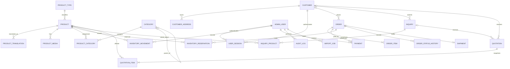

# Initial data model

The concrete schema is `packages/database/prisma/schema.prisma`. This ERD shows the main relationships; audit, settings, media, and import support tables are omitted from the diagram to keep it readable.

Inventory is modeled as an auditable movement ledger plus expiring reservations. The API must create/consume/release reservations and write movement rows in the same database transaction as the order or shop sale. `onHandDelta` and `reservedDelta` separately record physical-stock and reservation changes. Availability is derived from these quantities and active reservations, not trusted from a browser field. A physical unit is uniquely identified by SKU; quantity greater than one represents identical stock under that SKU. The API must prevent unsupported quantities for one-of-a-kind product records.

`OrderItem` and `QuotationItem` retain historical descriptive and pricing snapshots so later catalog edits do not rewrite customer history. `SiteSetting` stores configurable currency/business configuration as JSON, with access and audit policy enforced by the API.

The initial migration has been applied to the local PostgreSQL database. This is still a first schema baseline, not a production-validated data model. Constraint and transaction refinements belong with the inventory/order service implementation.
